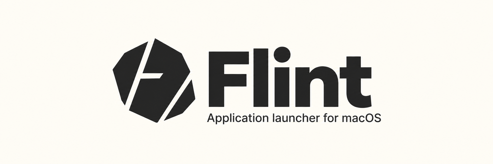

# Flint



A lightweight AppKit launcher for macOS 13+. No external dependencies.

**Combine any optional features to build the launcher you want.** Disabled feature paths are excluded at compile time to avoid unnecessary runtime work. Application search and launching are always available.

## Choose your features

All features are enabled by default. Mix any of these names:

| Feature | Build name |
| --- | --- |
| Calculator | `calculator` |
| Unix / ISO 8601 timestamps | `timestamps` |
| Color conversion | `colors` |
| Number base conversion | `number-bases` |
| QR codes | `qr` |
| DeepSeek translation | `translation` |
| Quick links with placeholders | `quick-links` |
| Local script commands | `scripts` |
| Eject disks, empty Trash, show desktop | `system-actions` |

```sh
sh scripts/build.sh  # Toggle features, then Enter to build
sh scripts/build.sh --features calculator,colors,qr
sh scripts/build.sh --features none  # Application launcher only
sh scripts/build.sh --features all -configuration Release
```

For a persistent selection, keep only the flags you want in [Config/Features.xcconfig](Config/Features.xcconfig). This applies to Debug and Release and supplies the picker's initial selection. Running without arguments opens the picker; explicit build options skip it unless you add `--interactive`. Rebuild to change features. Disabled features disappear from search and Settings; saved preferences remain available for future builds. Shared model and view types remain compiled, so feature selection does not guarantee a smaller binary.

## Build and run

Building requires Xcode 27 or later with the macOS 27 SDK or later. The app targets macOS 13 and later.

Open `Flint.xcodeproj`, select **Flint**, and run on **My Mac**, or use:

```sh
sh scripts/build.sh
open build/Build/Products/Debug/Flint.app
```

Local builds use ad hoc signing. You can build and run Flint without an Apple Developer account or a signing certificate. Extra build-script arguments pass through to `xcodebuild`.

## Use

Press **Command–Space**, type to search, use **Up / Down** to select, and press **Return** to run or copy. **Escape** or clicking away dismisses Flint. **Command–Comma** opens Settings, where you can change the shortcut, enable launch at login, and configure features.

Calculations and conversions appear as you type. Add quick links and script folders in Settings; translation requires a DeepSeek API key. Flint follows the system appearance and supports Reduce Motion.

## Development

`Flint/` contains the AppKit app; `Sources/FlintCore/` contains core logic. Optional features live in each target's `Features/` folder, with matching tests under `Tests/`.

```sh
python3 -B -m unittest discover -s Tests/BuildHelperTests
swift test
sh scripts/check-appearance.sh
sh scripts/check-appearance.sh --features calculator,translation
cognitive --threshold 15 Sources Flint Tests
```

Appearance checks run offscreen. Standalone Swift package builds enable all features.

## License

[MIT](LICENSE). See [third-party notices](THIRD_PARTY_NOTICES.md) for other terms.
